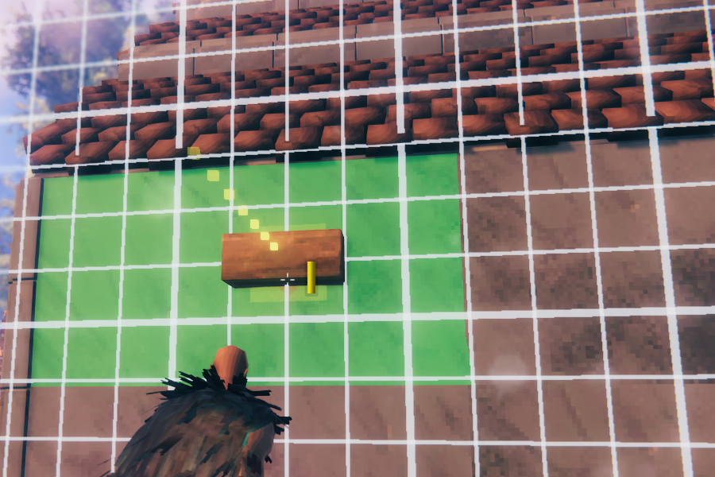
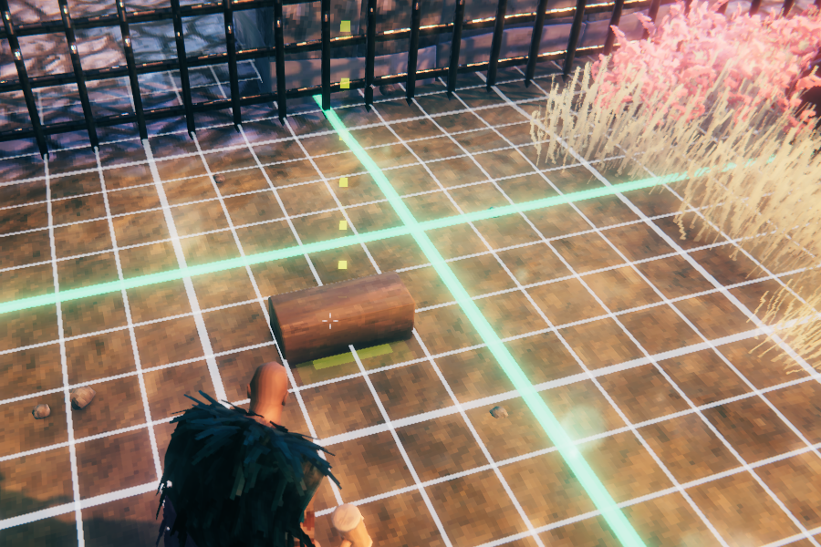
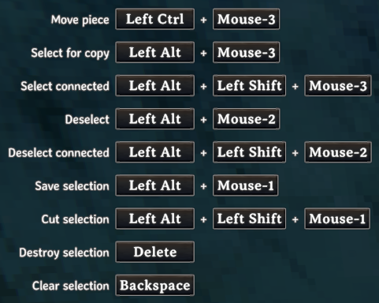

# BetterHammer

This mod adds several improvements to the vanilla base hammer:

- **No hammer required**: Open the build menu without a hammer in your inventory by pressing `B`.
- **Use nearby materials**: Use materials from the ground and nearby chests when your inventory runs short.
- **Build grid**: Toggle the build grid by pressing `Ctrl+Right-Click`. Adjust the grid distance by scrolling while holding `Ctrl`.
- **Copying structures**: Select built pieces to copy by looking at them and pressing `Alt+Middle-Click`, and deselect them with `Alt+Right-Click`. Add `Shift` to select or deselect a whole build at once. Once you have selected the pieces you want to copy, save them as a copy in the Copies tab with `Alt+Left-Click`, or cut them with `Alt+Shift+Left-Click` to save the copy and remove the originals.
- **Move pieces**: Move individual built pieces or entire selections with `Ctrl+Middle-Click`. Then left-click to put them down at a new location, or right-click to abort.
- **Undo and redo**: Undo your last build, move or removal with `Ctrl+Z`, and redo it with `Ctrl+Y`.
- **Repair mode**: Toggle repair mode by pressing `Shift+Right-Click`.
- **Zoom camera**: Zoom the camera in and out without needing to unequip the hammer by scrolling while holding `Alt`.
- **Sectioned build menu**: Pieces are grouped under headers you can collapse, every category is split into sections such as beams, poles and angled walls, and modded pieces have their own category.

## Build Grid

While placing a piece, a grid is drawn on the surface you are aiming at and pieces snap to its vertices.

- The grid aligns with the terrain and surfaces except for diagonal surfaces.
- The chunk borders are drawn as red lines, and the centrelines of the chunk are green.

| Key                | Action                    |
| ------------------ | ------------------------- |
| `Ctrl+Right-Click` | Toggle the build grid.    |
| `Ctrl+Scroll`      | Adjust the grid distance. |

## Copying and Moving

Look at built pieces and press `Alt+Middle-Click` to select them. Then:

| Key                      | Action                                                         |
| ------------------------ | -------------------------------------------------------------- |
| `Alt+Left-Click`         | Name the selection and save it in the hammer's **Copies** tab. |
| `Alt+Shift+Left-Click`   | Cut: save the selection as a copy, then remove the originals.  |
| `Ctrl+Middle-Click`      | Move the whole selection, or the piece you are looking at.     |
| `Alt+Shift+Middle-Click` | Select the piece and every piece connected to it.              |
| `Alt+Right-Click`        | Deselect the piece you are looking at.                         |
| `Alt+Shift+Right-Click`  | Deselect the piece and every piece connected to it.            |
| `Backspace`              | Clear the selection. With nothing selected, select the last cleared or saved selection again. |
| `Delete`                 | Destroy every selected piece, dropping their materials.        |
| `Q`/`E`                  | Cycle snap points while placing a copy or moved selection.     |
| `Shift+Q`/`Shift+E`      | Cycle through pieces while placing a copy or moved selection.  |

- Build a saved copy like any other piece. Hold `Alt` to see the selection's total materials.
- Moving is free and keeps everything inside, so chests don't need emptying. Ward and workbench rules apply, and ships and carts can't be moved.
- Copies are saved in `BepInEx/config/BetterHammer/copies.json` for all your characters and worlds. To rename or delete one, hover it in the build menu and press `Insert` or `Delete`.

## Undo and Redo

| Key      | Action                                |
| -------- | ------------------------------------- |
| `Ctrl+Z` | Undo the last build, move or removal. |
| `Ctrl+Y` | Redo the last action you undid.       |

- This covers building pieces and copies, moving pieces and selections, and removing pieces with the hammer, `Delete` or Cut.
- If any of the pieces can't be handled, for example because they're too far away or behind someone else's ward, nothing happens.
- The history lasts until you log out and holds 50 actions by default.

## Build Menu

The build menu is taller than the game's, its categories are grouped into Construction, Utility, Comfort, Food and Mods, and the pieces are split into sections, each with a header and its own grid.

- **Show All** has a section for each category. Every piece is in exactly one category, the most fitting of the ones the game gives it, so a wall is under Walls rather than Building. **Building** shows every piece in the construction categories, by category.
- **Each category** is split into sections: for example Beams, Diagonal beams, Roof crosses, Arches, and Poles and pillars under Architecture, and a section for each crafting station with its upgrades under Crafting.
- **Materials** lists the materials by biome, from Meadows to Deep North. Its Show All is split by the biome of each piece's main material, and each material by category.
- **Recent** is split by category, with the most recent pieces first in each.
- **Favorites** is split into your favourites categories, then Uncategorised.
  - Drag a piece to rearrange it, or onto another section to move it there. Dropping it on Uncategorised takes it out of its categories.
  - Drag a category in the list on the left to reorder it, and right-click it to rename it.
  - This works while Favorites is grouped by Type and sorted by Default.
- **Modded** has every piece added by other mods, with a section per mod. Modded pieces also appear in the sections they fit, and again in a Modded section at the bottom.
- Each entry in the lists on the left shows how many pieces it has. Copies named with a folder, such as `Base/Tower`, are grouped by folder in the Copies tab.
- Hover a piece and press `H` to hide it from every tab. Hidden pieces are listed in the Hidden category, where `H` brings them back.
- Search by name or material as usual, or with a prefix: `@` for the mod a piece comes from, `#` for its section, and `$` for a material it needs (`@half beam`, `#roof`, `$iron`).
- Click a header to collapse its section. Collapsed sections are remembered and open up while you search.
- The bar above the pieces has the search box and repair button on the right, and **Group by**, **Sort by** and **Show** on the left. Group by and Sort by change how the current tab is laid out, and Show switches between all pieces and only those you have the materials for, counting nearby chests. Click to step forward through the options, and right-click to step back. Each tab remembers its own choice.
  - Group by: Type (the sections above), Material (the material a piece needs most of), Crafting station, or None.
  - Sort by: Default (the game's order, or most recent first in Recent), Name, Material, or Crafting station. It doesn't offer what the pieces are already grouped by.

Where pieces go is set by rules in `BepInEx/config/BetterHammer/build_menu_rules.json`. The built-in rules are written next to it as `build_menu_rules.defaults.json`, to copy from:

- `Moves` puts a piece in another category, by prefab name: `"Sled": "Transport"`.
- `Biomes` lists the biomes in order, each with the materials found there, by item prefab name: `{ "Name": "$biome_meadows", "Items": [ "Wood", "Stone" ] }`. It replaces the whole list.
- `Sections` replaces a category's sections. Each section has a `Name` and a `Match`, a regular expression on the prefab name; the first match wins, and a section with `"Fallback": true` takes the rest.

Categories are named as in the game's code: `Misc`, `Crafting`, `Building`, `Floor`, `Wall`, `Roof`, `Architecture`, `Furniture`, `Lighting`, `Decor`, `Storage`, `Transport`, `Food`, `Meads`, `Feasts`, `Defense`, `Stacks`, `Stairs`, `Doors` and `Seasonal`. Set `Sections` to false under `Build Menu` in the config to use the game's own menu, and change `Icon Size` there to fit more or fewer pieces in each row.

## Keyhints

The mod adds on-screen keyhints with all the listed keybinds.

### Left Panel

The left panel focuses on the Copy, Move, Cut and Delete functionality:

### Right Panel

The right panel focuses on the build grid and utility functions:

## Configuration

Settings are in the BepInEx config file `javidahmed64592.betterhammer.cfg`.
Settings marked "(Synced with server)" use the server's values when the server has the mod installed.

## Compatibility

- Mods that also build from nearby chests or ground items (such as AzuCraftyBoxes, or the craft from chests option in Valheim Plus) overlap with this mod's materials feature. Turn one of them off: here, set `Use Nearby Chests` to false and the ground items `Radius` to 0.
- Mods that change how pieces snap or add their own build key hints may clash with the build grid or its hints.
- Other mods that change the build menu's piece grid or categories may clash with the sectioned menu. Set `Sections` to false under `Build Menu` to leave the menu to them.
- This mod has not been tested with a gamepad, only with keyboard and mouse.

## Uninstalling

Nothing is saved to your world, so the mod can be removed at any time. Favourites categories you rename or reorder are saved in your character the game's way and keep working without the mod. Saved copies and the build menu's settings, including the order you arranged favourites in, stay in `BepInEx/config/BetterHammer/` until you delete them.

## License

This project is licensed under the MIT License - see the [LICENSE](https://github.com/javidahmed64592/Valheim-BetterHammer/blob/main/LICENSE) file for details.
