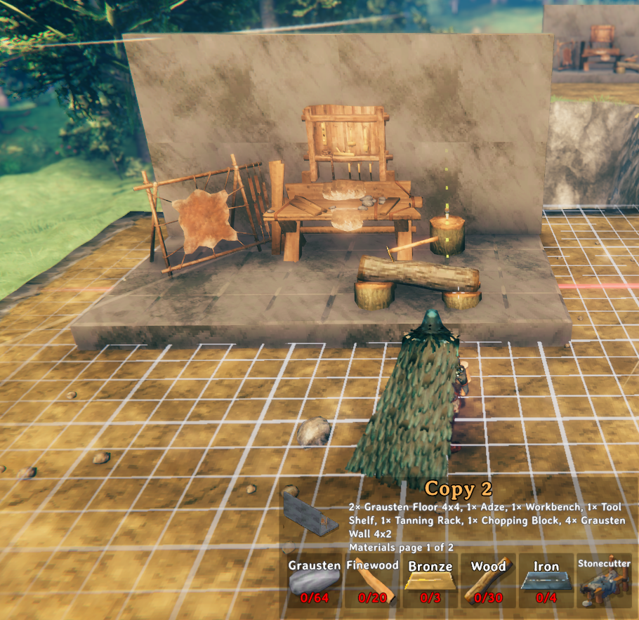

# BetterHammer

This mod adds several improvements to the vanilla base hammer:

- **No hammer required**: Open the build menu without a hammer in your inventory by pressing `B`.
- **Use nearby materials**: Use materials from the ground and nearby chests when your inventory runs short.
- **Build grid**: Toggle the build grid by pressing `Ctrl+Right-Click`. Adjust the grid distance by scrolling while holding `Ctrl`.
- **Copying structures**: Select built pieces to copy by looking at them and pressing `Alt+Middle-Click`, and deselect them with `Alt+Right-Click`. Add `Shift` to select or deselect a whole build at once. Once you have selected the pieces you want to copy, save them as a copy in the Copies tab with `Alt+Left-Click`, or cut them with `Alt+Shift+Left-Click` to save the copy and remove the originals.
- **Move pieces**: Move individual built pieces or entire selections with `Ctrl+Middle-Click`. Then left-click to put them down at a new location, or right-click to abort.
- **Undo and redo**: Undo your last build, move or removal with `Ctrl+Z`, and redo it with `Ctrl+Y`.
- **Repair mode**: Toggle repair mode by pressing `Shift+Right-Click`.
- **Zoom camera**: Zoom the camera in and out without needing to unequip the hammer by scrolling while holding `Alt`.

## Build Grid

While placing a piece, a grid is drawn on the surface you are aiming at and pieces snap to its vertices.

- The grid aligns with the terrain and surfaces except for diagonal surfaces.
- The chunk borders are drawn as red lines, and the centrelines of the chunk are green.

| Key                | Action                    |
| ------------------ | ------------------------- |
| `Ctrl+Right-Click` | Toggle the build grid.    |
| `Ctrl+Scroll`      | Adjust the grid distance. |

## Copying and Moving

Look at built pieces and press `Alt+Middle-Click` to select them. Then:

| Key                      | Action                                                         |
| ------------------------ | -------------------------------------------------------------- |
| `Alt+Left-Click`         | Name the selection and save it in the hammer's **Copies** tab. |
| `Alt+Shift+Left-Click`   | Cut: save the selection as a copy, then remove the originals.  |
| `Ctrl+Middle-Click`      | Move the whole selection, or the piece you are looking at.     |
| `Alt+Shift+Middle-Click` | Select the piece and every piece connected to it.              |
| `Alt+Right-Click`        | Deselect the piece you are looking at.                         |
| `Alt+Shift+Right-Click`  | Deselect the piece and every piece connected to it.            |
| `Backspace`              | Clear the selection.                                           |
| `Delete`                 | Destroy every selected piece, dropping their materials.        |
| `Q`/`E`                  | Cycle snap points while placing a copy or moved selection.     |
| `Shift+Q`/`Shift+E`      | Cycle through pieces while placing a copy or moved selection.  |

- Build a saved copy like any other piece. Hold `Alt` to see the selection's total materials.
- Moving is free and keeps everything inside, so chests don't need emptying. Ward and workbench rules apply, and ships and carts can't be moved.
- Copies are saved in `BepInEx/config/BetterHammer/copies.json` for all your characters and worlds. To rename or delete one, hover it in the build menu and press `Insert` or `Delete`.

## Undo and Redo

| Key      | Action                                |
| -------- | ------------------------------------- |
| `Ctrl+Z` | Undo the last build, move or removal. |
| `Ctrl+Y` | Redo the last action you undid.       |

- This covers building pieces and copies, moving pieces and selections, and removing pieces with the hammer, `Delete` or Cut.
- Undo and redo follow the normal building rules. Undoing a build removes the pieces and drops their materials. Undoing a removal builds the pieces again for the usual materials, and the dropped ones count while they're nearby. Moving is free.
- If any of the pieces can't be handled, for example because they're too far away or behind someone else's ward, nothing happens.
- A rebuilt chest or sign starts empty. The history lasts until you log out and holds 50 actions by default.

## Configuration

Settings are in the BepInEx config file `javidahmed64592.betterhammer.cfg`.
Settings marked "(Synced with server)" use the server's values when the server has the mod installed.

## Compatibility

- Mods that also build from nearby chests or ground items (such as AzuCraftyBoxes, or the craft from chests option in Valheim Plus) overlap with this mod's materials feature. Turn one of them off: here, set `Use Nearby Chests` to false and the ground items `Radius` to 0.
- Mods that change how pieces snap or add their own build key hints may clash with the build grid or its hints.
- This mod has not been tested with a gamepad, only with keyboard and mouse.

## Uninstalling

Nothing is saved to your world or character, so the mod can be removed at any time.

## License

This project is licensed under the MIT License - see the [LICENSE](https://github.com/javidahmed64592/Valheim-BetterHammer/blob/main/LICENSE) file for details.
