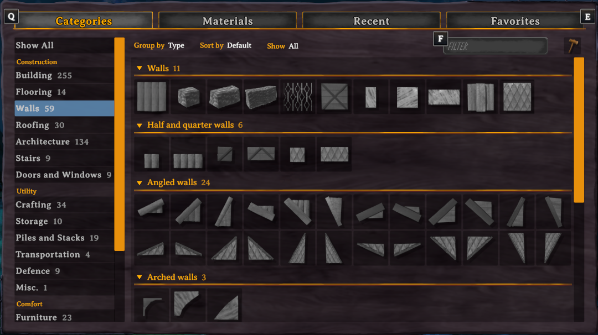
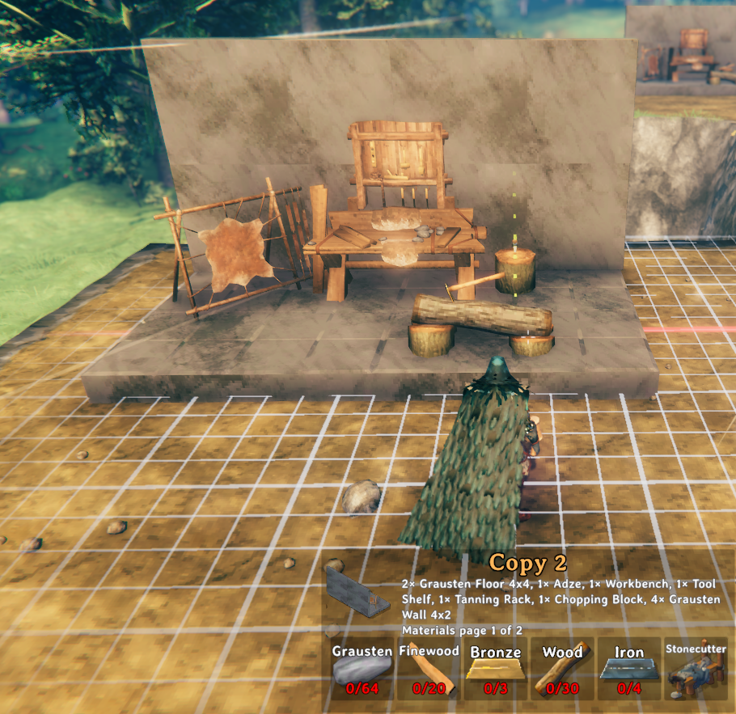
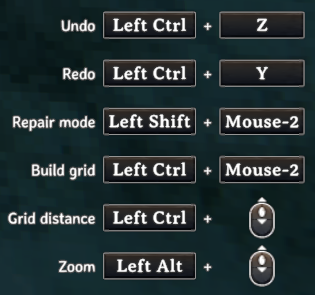

# BetterHammer

Find pieces fast in a sectioned build menu, snap to a build grid, copy, move and undo builds, build with nearby materials, and open the build menu without a hammer.

- **Sectioned build menu**: Every category and tab is split into sections under headers you can collapse, with your own grouping, sorting, favourites and hidden pieces.
- **Build grid**: Snap pieces to a grid drawn on the surface you aim at. Toggle it with `Ctrl+Right-Click` and change its spacing with `Ctrl+Scroll`.
- **Copying structures**: Select built pieces with `Alt+Middle-Click`, save them as a copy with `Alt+Left-Click`, and build the copy like any other piece.
- **Move pieces**: Move a piece or a whole selection with `Ctrl+Middle-Click`, keeping everything inside.
- **Undo and redo**: Undo your last build, move or removal with `Ctrl+Z`, and redo it with `Ctrl+Y`.
- **No hammer required**: Press `B` to open the build menu without a hammer in your inventory.
- **Use nearby materials**: Build with materials from the ground and nearby chests when your inventory runs short.
- **Repair mode**: Toggle repair mode with `Shift+Right-Click`.
- **Zoom camera**: Zoom the camera with `Alt+Scroll` without putting the hammer away.

## Build Menu

The build menu is taller than the game's, and every tab is split into sections, each with a header and its own grid.
The categories on the left are grouped into Construction, Utility, Comfort, Food and Mods, the materials by biome, and each entry shows how many pieces it has.
The bar above the pieces holds the search box and repair button, and three options that you click to step through and right-click to step back.

| Key or control                    | Action                                                                        |
| --------------------------------- | ----------------------------------------------------------------------------- |
| Click a header                    | Collapse or expand its section.                                               |
| **Group by**                      | Split the tab by Type (its own sections), Material, Crafting station or None. |
| **Sort by**                       | Order each section by Default, Name, Material or Crafting station.            |
| **Show**                          | Show all pieces, or only those you have the materials for.                    |
| `H`                               | Hide the piece you're hovering, or bring it back in the Hidden category.      |
| Drag a favourite                  | Rearrange it, or move it to another favourites category.                      |
| Drag a favourites category        | Move it up or down the list.                                                  |
| Right-click a favourites category | Rename it.                                                                    |

- **Categories**: Show All has a section for each category. Every piece is in exactly one category, so a wall is under Walls rather than Building. Each category is split further, such as Beams, Diagonal beams and Arches under Architecture, or a section for each crafting station and its upgrades under Crafting. Building shows every construction piece, by category.
- **Materials**: Show All is split by the biome of each piece's main material, from Meadows to Deep North, and each material by category.
- **Recent**: Split by category, with the most recent pieces first in each.
- **Favorites**: A section for each of your favourites categories, then Uncategorised. Dropping a favourite on Uncategorised takes it out of its categories. Arranging works while Favorites is grouped by Type and sorted by Default.
- **Modded and Hidden**: Modded has every piece other mods add, with a section per mod; those pieces also show in the sections they fit and in a Modded section at the bottom. Hidden lists the pieces you hid.
- **Search**: Search by name or material as usual, or with a prefix: `@` for the mod a piece comes from, `#` for its section, and `$` for a material it needs (`@half beam`, `#roof`, `$iron`).
- **Copies**: Copies named with a folder, such as `Base/Tower`, are grouped by folder in the Copies tab.
- Collapsed sections, grouping, sorting, hidden pieces and the order of your favourites are remembered for all your characters. Your favourites categories themselves stay in your character, as in the game.

### Where Pieces Go

Pieces are sorted by rules in `BepInEx/config/BetterHammer/build_menu_rules.json`. The built-in rules are written next to it as `build_menu_rules.defaults.json` to copy from.

| Rule       | What it does                                                                                                                                                                          |
| ---------- | ------------------------------------------------------------------------------------------------------------------------------------------------------------------------------------- |
| `Moves`    | Puts a piece in another category, by prefab name: `"Sled": "Transport"`.                                                                                                              |
| `Sections` | Replaces a category's sections. Each has a `Name` and a `Match`, a regular expression on the prefab name; the first match wins, and a section with `"Fallback": true` takes the rest. |
| `Biomes`   | Lists the biomes in order, each with its materials by item prefab name. It replaces the whole list.                                                                                   |

- Categories are named as in the game's code: `Misc`, `Crafting`, `Building`, `Floor`, `Wall`, `Roof`, `Architecture`, `Furniture`, `Lighting`, `Decor`, `Storage`, `Transport`, `Food`, `Meads`, `Feasts`, `Defense`, `Stacks`, `Stairs`, `Doors` and `Seasonal`.
- Set `Sections` to false under `Build Menu` in the config to use the game's own menu, and change `Icon Size` there to fit more or fewer pieces in each row.

## Build Grid

While placing a piece, a grid is drawn on the surface you are aiming at and pieces snap to its vertices.

- The grid aligns with the terrain and surfaces except for diagonal surfaces.
- The chunk borders are drawn as red lines, and the centrelines of the chunk are green.

| Key                | Action                    |
| ------------------ | ------------------------- |
| `Ctrl+Right-Click` | Toggle the build grid.    |
| `Ctrl+Scroll`      | Adjust the grid distance. |

## Copying and Moving

Look at built pieces and press `Alt+Middle-Click` to select them. Then:

| Key                      | Action                                                         |
| ------------------------ | -------------------------------------------------------------- |
| `Alt+Left-Click`         | Name the selection and save it in the hammer's **Copies** tab. |
| `Alt+Shift+Left-Click`   | Cut: save the selection as a copy, then remove the originals.  |
| `Ctrl+Middle-Click`      | Move the whole selection, or the piece you are looking at.     |
| `Alt+Shift+Middle-Click` | Select the piece and every piece connected to it.              |
| `Alt+Right-Click`        | Deselect the piece you are looking at.                         |
| `Alt+Shift+Right-Click`  | Deselect the piece and every piece connected to it.            |
| `Backspace`              | Clear the selection. With nothing selected, select the last cleared or saved selection again. |
| `Delete`                 | Destroy every selected piece, dropping their materials.        |
| `Q`/`E`                  | Cycle snap points while placing a copy or moved selection.     |
| `Shift+Q`/`Shift+E`      | Cycle through pieces while placing a copy or moved selection.  |

- Build a saved copy like any other piece. Hold `Alt` to see the selection's total materials.
- Moving is free and keeps everything inside, so chests don't need emptying. Ward and workbench rules apply, and ships and carts can't be moved.
- Copies are saved in `BepInEx/config/BetterHammer/copies.json` for all your characters and worlds. To rename or delete one, hover it in the build menu and press `Insert` or `Delete`.

## Undo and Redo

| Key      | Action                                |
| -------- | ------------------------------------- |
| `Ctrl+Z` | Undo the last build, move or removal. |
| `Ctrl+Y` | Redo the last action you undid.       |

- This covers building pieces and copies, moving pieces and selections, and removing pieces with the hammer, `Delete` or Cut.
- If any of the pieces can't be handled, for example because they're too far away or behind someone else's ward, nothing happens.
- The history lasts until you log out and holds 50 actions by default.

## Keyhints

The mod adds on-screen keyhints with all the listed keybinds.

### Left Panel

The left panel focuses on the Copy, Move, Cut and Delete functionality:

### Right Panel

The right panel focuses on the build grid and utility functions:

## Configuration

Settings are in the BepInEx config file `javidahmed64592.betterhammer.cfg`.
Settings marked "(Synced with server)" use the server's values when the server has the mod installed.

## Compatibility

- Mods that also build from nearby chests or ground items (such as AzuCraftyBoxes, or the craft from chests option in Valheim Plus) overlap with this mod's materials feature. Turn one of them off: here, set `Use Nearby Chests` to false and the ground items `Radius` to 0.
- Mods that change how pieces snap or add their own build key hints may clash with the build grid or its hints.
- Other mods that change the build menu's piece grid or categories may clash with the sectioned menu. Set `Sections` to false under `Build Menu` to leave the menu to them.
- This mod has not been tested with a gamepad, only with keyboard and mouse.

## Uninstalling

Nothing is saved to your world, so the mod can be removed at any time. Favourites categories you rename or reorder are saved in your character the game's way and keep working without the mod. Saved copies and the build menu's settings, including the order you arranged favourites in, stay in `BepInEx/config/BetterHammer/` until you delete them.

## License

This project is licensed under the MIT License - see the [LICENSE](https://github.com/javidahmed64592/Valheim-BetterHammer/blob/main/LICENSE) file for details.
